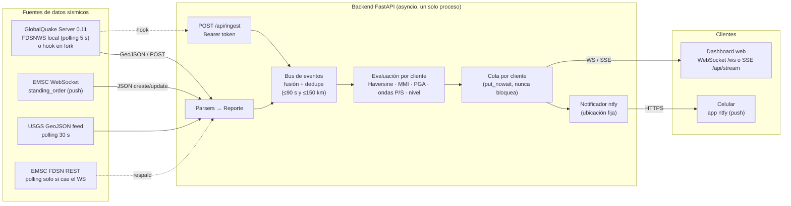
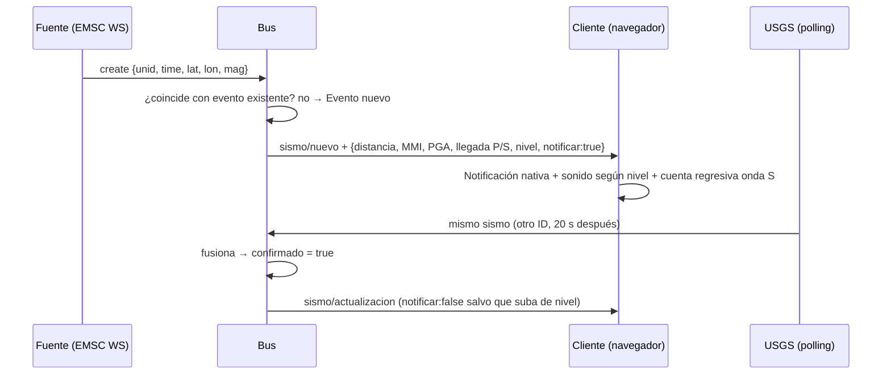

# Arquitectura — Sismo RT

## Visión general

## Flujo de un sismo

## Decisiones clave

| Tema | Decisión | Por qué |
|---|---|---|
| Canal principal | WebSocket de EMSC (*standing order*) | Es el único canal **push** público y global; evita el polling. |
| GlobalQuake | Su servidor FDSNWS-event (GlobalQuake Server 0.11) consultado cada 5 s; opcionalmente un hook en un fork que hace `POST /api/ingest` | El protocolo cliente-servidor de GlobalQuake es propio, pero el servidor incluye una API FDSNWS estándar (apagada por defecto). El repositorio abierto está descontinuado desde la 1.0.0. Ver [GLOBALQUAKE.md](GLOBALQUAKE.md). |
| Respaldo | USGS siempre (confirma) + EMSC REST solo si el WS lleva caído > 20 s | Dos catálogos independientes; no se duplica tráfico cuando el WS funciona. |
| Fusión | Mismo sismo si \|Δt\| ≤ 90 s y distancia ≤ 150 km | Las fuentes usan IDs distintos y localizaciones preliminares que difieren. El valor "oficial" sale de la fuente de mayor prioridad: USGS > EMSC > GlobalQuake. |
| Personalización | Se calcula **en el servidor por cliente** | El cliente envía su GPS; recibe distancia, intensidad y nivel ya calculados. Cálculo O(clientes) por sismo, barato. |
| Baja latencia | Difusión síncrona con `put_nowait`; E/S lenta (ntfy) en tareas aparte | Un sismo nuevo llega a todos los sockets en microsegundos tras recibirse; un cliente lento descarta mensajes viejos en vez de frenar al resto. |
| Anti-spam | Se notifica la 1.ª vez y solo si **sube** de nivel | Las correcciones de magnitud generan "actualización" para el mapa, no una nueva alarma. |
| Eventos atrasados | `notificar=false` si el sismo tiene más de 30 min | Al reiniciar o cuando un catálogo publica tarde, se muestra en el mapa sin alarmar. |
| Transporte al navegador | WebSocket **y** SSE | WS permite cambiar la ubicación en vivo; SSE es más simple y reconecta solo. |

## Modelo de cálculo

- **Distancia epicentral**: Haversine sobre una esfera de radio 6371 km.
- **Distancia hipocentral**: `√(epicentral² + profundidad²)`.
- **Intensidad (MMI)**: ecuación de predicción de Allen, Wald & Worden (2012) para regiones
  corticales activas, con distancia hipocentral:
  `MMI = 2.085 + 1.428·M − 1.402·ln√(R² + (−0.209 + 2.042·e^(M−5))²) + 0.078·ln(R/50)` (el último término
  solo si R > 50 km). Coeficientes verificados contra `AllenEtAl2012Rhypo` de OpenQuake.
- **PGA**: inversión de la relación MMI–PGA de Worden et al. (2012): `MMI = 1.78 + 1.55·log10(PGA)` si
  MMI ≤ 4.22, si no `MMI = −1.60 + 3.70·log10(PGA)`, con PGA en cm/s². Verificado contra `wgrw12` de
  USGS ShakeMap (`esi-shakelib`).
- **Ondas P y S**: velocidades medias constantes (Vp = 6.5 km/s, Vs = 3.75 km/s, configurables).
  Es una aproximación de trayectoria recta: buena hasta algunos cientos de km.
- **Nivel**:
  - `null`: no relevante (más lejos que `RADIO_KM` y magnitud < `MAG_GLOBAL`). Solo mapa.
  - `info`: relevante, pero magnitud < 4.0 o intensidad estimada < III.
  - `alerta`: magnitud ≥ 4.0 **y** intensidad estimada ≥ III en tu ubicación.

## Límites honestos del sistema

1. **Los catálogos no son alerta temprana.** EMSC y USGS publican un sismo entre ~1 y 20 minutos
   después del origen. Para un sismo cercano, la onda S ya habrá pasado; el contador solo tiene
   sentido con detecciones de segundos (GlobalQuake) o para sismos lejanos.
2. **GlobalQuake es experimental**; sus autores advierten que puede dar información errónea y que los
   M6+ suelen producir detecciones falsas o duplicadas. Además, el código abierto está descontinuado.
   Por eso sus eventos llegan marcados `confirmado: false` hasta que un catálogo los confirma.
3. **La atenuación de Allen 2012 está calibrada para corteza activa.** En la subducción chilena
   (sismos interplaca e intraplaca profundos) es una aproximación; úsala como orden de magnitud.
4. La fuente oficial en Chile es el **SAE de SENAPRED** y el **CSN** (sismologia.cl).
